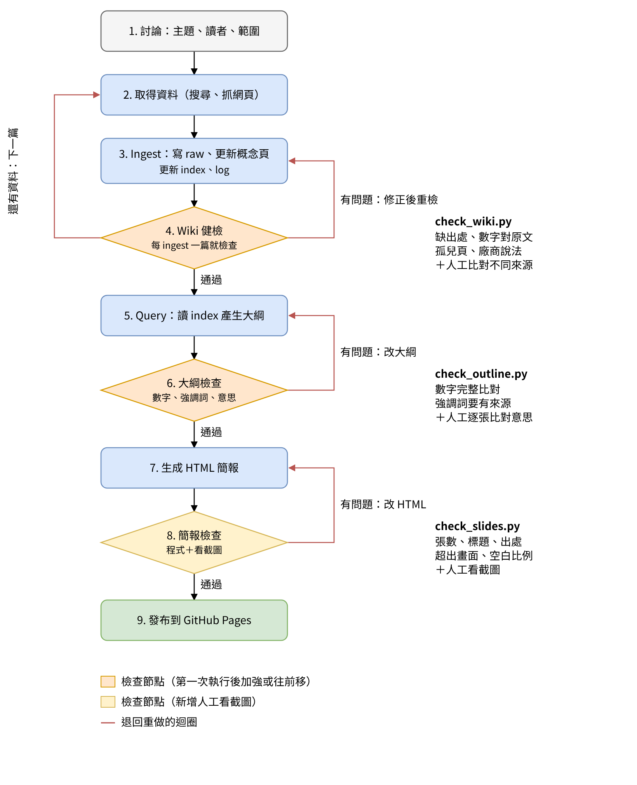

# SAP 入門 LLM Wiki 與教學簡報

用 LLM Wiki 的方式整理「SAP 是什麼？」的知識，再用這個 Wiki 當作知識庫，產生一份給修課同學看的教學 HTML 簡報。

- 教學簡報：https://zoe68866.github.io/sap-llm-wiki/
- Wiki 目錄：[wiki/index.md](wiki/index.md)
- 規則檔（schema）：[CLAUDE.md](CLAUDE.md)
- 討論紀錄：[discussion.md](discussion.md)
- 檢查紀錄：[checks/check-log.md](checks/check-log.md)

## 架構

```text
sap-llm-wiki/
├── CLAUDE.md          規則檔：raw / wiki 怎麼寫、怎麼檢查、怎麼產生簡報
├── discussion.md      開始前的討論紀錄（先討論、後生成）
├── raw/               原始資料 7 篇（S01 到 S07），只讀不改
├── wiki/              概念頁 7 頁＋index.md 目錄＋log.md 日誌
├── outline.md         簡報大綱，每張投影片標出用到的 wiki 頁面
├── checks/            3 個檢查程式與檢查紀錄
├── index.html         教學 HTML 簡報（16 張）
└── workflow-graph.png 流程圖
```

## 資料來源（ingest 7 篇）

| 代號 | 來源 | 類型 |
| --- | --- | --- |
| S01 | SAP History | 官方 |
| S02 | What is SAP? | 官方 |
| S03 | What is SAP ERP?（TechTarget） | 科技媒體 |
| S04 | SAP ECC End of Maintenance 2027 | 顧問公司（廠商說法） |
| S05 | ABAP Overview | 官方 |
| S06 | Introducing the SAP GUI（SAP Learning） | 官方學習平台 |
| S07 | 我的 SAP 新手筆記 | 自己的筆記 |

## 流程（loop / graph）



1. 討論主題、讀者、範圍
2. 取得資料
3. Ingest：寫 raw、更新概念頁、index、log
4. Wiki 健檢（每 ingest 一篇就檢查，有問題退回第 3 步）
5. Query：讀 index 產生大綱
6. 大綱檢查（數字、強調詞、意思，有問題退回第 5 步）
7. 生成 HTML 簡報
8. 簡報檢查（程式＋看截圖，有問題退回第 7 步）
9. 發布到 GitHub Pages

## 執行檢查

```bash
python checks/check_wiki.py      # Wiki 健檢
python checks/check_outline.py   # 大綱檢查
python checks/check_slides.py    # 簡報檢查（需要 playwright）
```
